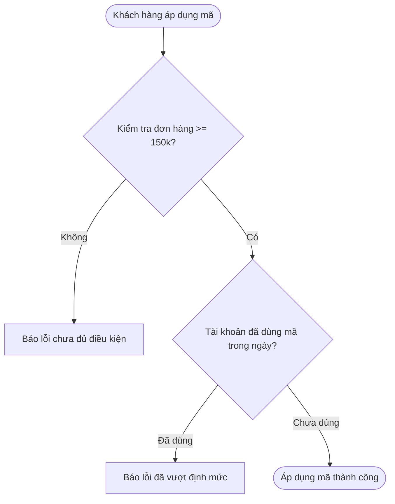

# [Thực hành] Viết Acceptance Criteria theo cấu trúc Given – When – Then - Dự án GoMart

> 👤 **Học viên:** Đỗ Hoàng Sơn | **Mã SV:** PTIT-HCM-066
> 🏫 **Môn học:** IT206-K25-Agile-va-Scrum

---

## 📊 Sơ đồ thiết kế hệ thống (Flowchart)

> 💡 *Sơ đồ dưới đây được render tự động trực tiếp trên GitHub bằng Mermaid. Bạn cũng có thể tải file **`btth1.drawio`** trong repository này để mở và chỉnh sửa trực tiếp trên [Draw.io (diagrams.net)](https://app.diagrams.net).* 

---

## Bước 1: Rà soát 3 AC nháp

Dưới đây là phần đánh giá chi tiết 3 tiêu chí nghiệm thu (AC) nháp do Product Owner viết ban đầu cho User Story US-07:

| AC nháp | Trạng thái | Lý do không đo lường được |
| --- | --- | --- |
| AC-1: 'He thong xu ly ma freeship nhanh' | Chưa đạt | Từ 'nhanh' là cảm tính, hoàn toàn không có mốc thời gian cụ thể để Tester bấm giờ nghiệm thu. |
| AC-2: 'Giao dien nhap ma phai dep va de nhin' | Chưa đạt | Cụm từ 'đẹp, dễ nhìn' phụ thuộc vào góc nhìn chủ quan, không phải là thông số kỹ thuật rõ ràng. |
| AC-3: 'Khi nhap ma sai thi bao loi' | Chưa đạt | Thiếu hoàn toàn nội dung thông báo lỗi cụ thể là gì và lỗi đó hiển thị ở vị trí nào trên màn hình. |

## Bước 2: Viết lại 3 AC ở dạng đo lường được

Sau khi rà soát các điểm mơ hồ, mình viết lại 3 AC mới đưa vào các con số và điều kiện quan sát được cụ thể:

- AC-1 (Đã sửa): Hệ thống trừ phí giao hàng và cập nhật lại tổng tiền trên màn hình giỏ hàng trong vòng tối đa 2 giây kể từ khi người dùng bấm nút 'Áp dụng'.
- AC-2 (Đã sửa): Ô nhập mã freeship hiển thị ngay phía dưới danh sách sản phẩm trong giỏ hàng, có độ dài tối đa 20 ký tự và có nút 'Áp dụng' màu xanh ở bên cạnh.
- AC-3 (Đã sửa): Khi người dùng nhập sai mã hoặc mã không tồn tại, hệ thống hiển thị dòng chữ màu đỏ 'Mã freeship không hợp lệ hoặc đã hết hạn' ngay bên dưới ô nhập mã.

## Bước 3 & 4 & 5: Viết AC theo cấu trúc Given – When – Then cho kịch bản thành công và ngoại lệ

Viết chi tiết các kịch bản nghiệm thu bao gồm cả điều kiện thành công lẫn ngoại lệ, đồng thời làm rõ số tiền thanh toán cuối cùng ở vế Then:

- Kịch bản 1 (Thành công): Given giỏ hàng có tổng giá trị hàng hóa là 200.000đ và tài khoản chưa sử dụng mã freeship nào trong ngày. When khách hàng nhập mã hợp lệ và bấm nút 'Áp dụng'. Then hệ thống áp dụng mã miễn phí giao hàng 25.000đ, phí giao hàng thực tế về 0đ và tổng số tiền cuối cùng khách hàng phải thanh toán là 200.000đ.
- Kịch bản 2 - Ngoại lệ (a): Given giỏ hàng có tổng giá trị hàng hóa là 120.000đ (chưa đạt ngưỡng tối thiểu 150.000đ) và tài khoản chưa dùng mã trong ngày. When khách hàng bấm 'Áp dụng' mã freeship. Then hệ thống hiển thị thông báo 'Đơn hàng chưa đạt tối thiểu 150.000đ để dùng mã, còn thiếu 30.000đ', giữ nguyên phí giao hàng là 25.000đ và tổng số tiền khách hàng phải thanh toán là 145.000đ.
- Kịch bản 3 - Ngoại lệ (b): Given giỏ hàng có tổng giá trị hàng hóa là 200.000đ nhưng tài khoản đã sử dụng 1 mã freeship trước đó trong ngày. When khách hàng tiếp tục nhập và bấm 'Áp dụng' mã freeship thứ hai. Then hệ thống từ chối áp dụng, hiển thị thông báo 'Mỗi tài khoản chỉ được dùng 1 mã freeship mỗi ngày', giữ nguyên phí giao hàng 25.000đ và tổng số tiền khách hàng phải thanh toán là 225.000đ.

## Bước 6: Chuyển AC thành Test Case cho Tester

Chuyển hóa 3 kịch bản trên thành các Test Case chuẩn chỉnh với 4 cột để đội ngũ kiểm thử (Tester) có thể tiến hành test và sign-off ngay lập tức:

| Mã TC | Tiền điều kiện | Thao tác | Kết quả mong đợi |
| --- | --- | --- | --- |
| TC-US07-01 | Giỏ hàng 200.000đ, tài khoản chưa dùng mã trong ngày | Nhập mã freeship hợp lệ và bấm 'Áp dụng' | Phí ship giảm từ 25.000đ về 0đ. Tổng thanh toán đúng bằng 200.000đ. Thời phản hồi dưới 2 giây. |
| TC-US07-02 | Giỏ hàng 120.000đ, tài khoản chưa dùng mã trong ngày | Nhập mã freeship và bấm 'Áp dụng' | Báo lỗi thiếu 30.000đ. Phí giao hàng giữ nguyên 25.000đ. Tổng thanh toán là 145.000đ. |
| TC-US07-03 | Giỏ hàng 200.000đ, tài khoản đã dùng 1 mã trong ngày | Nhập mã freeship thứ hai và bấm 'Áp dụng' | Báo lỗi vượt giới hạn 1 mã/ngày. Phí giao hàng giữ nguyên 25.000đ. Tổng thanh toán là 225.000đ. |

## Bước 7: Lưu bài nộp

Bài tập thực hành đã hoàn thiện đầy đủ các yêu cầu rà soát, viết lại AC chuẩn Given - When - Then, định rõ số tiền thanh toán và chuyển đổi thành Test Case rõ ràng. Tệp tin được lưu dưới tên 'gomart_ac_given_when_then.docx' để chuẩn bị đẩy lên repository 'IT206-K25-Agile-va-Scrum' nộp cho giảng viên.

---

## 📁 Danh sách tệp tin nộp bài trong Repository
- 📝 `btth1.docx`: Báo cáo tài liệu phân tích nghiệp vụ hoàn chỉnh.
- 🎨 `btth1.drawio`: File thiết kế sơ đồ chuẩn theo quy định đề bài (mở trực tiếp bằng [Draw.io](https://app.diagrams.net) hoặc Lucidchart).
